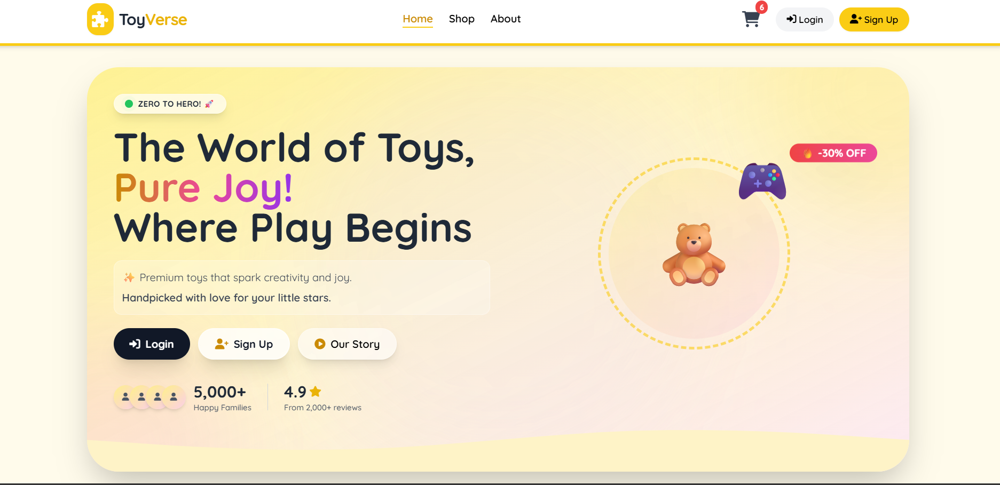
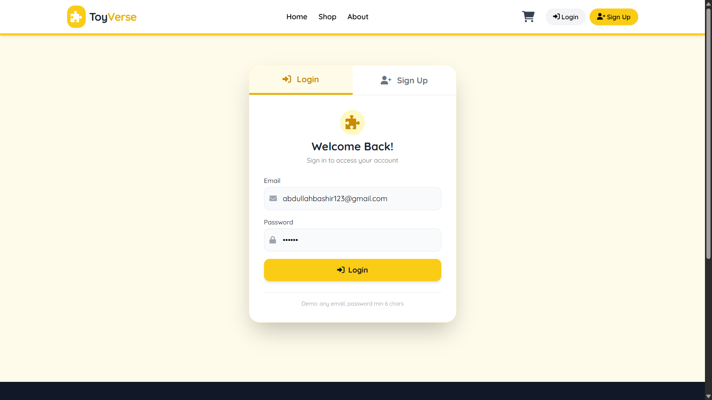
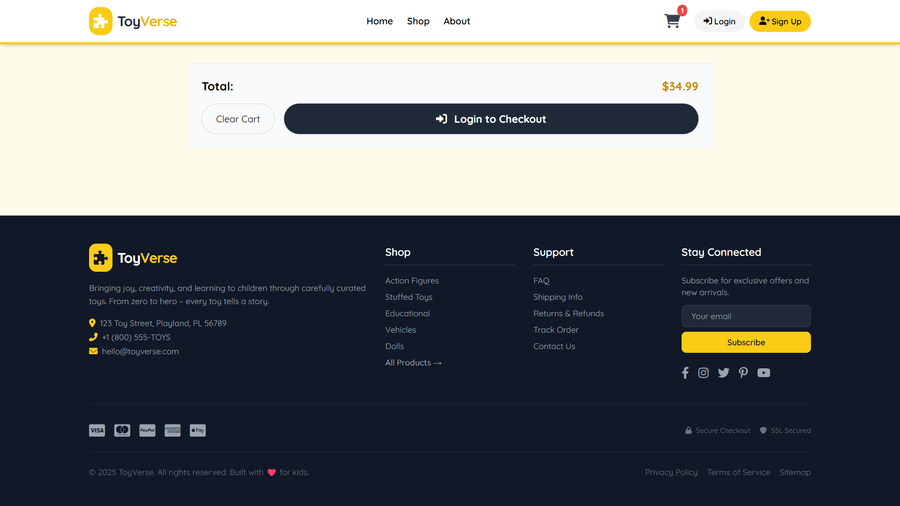
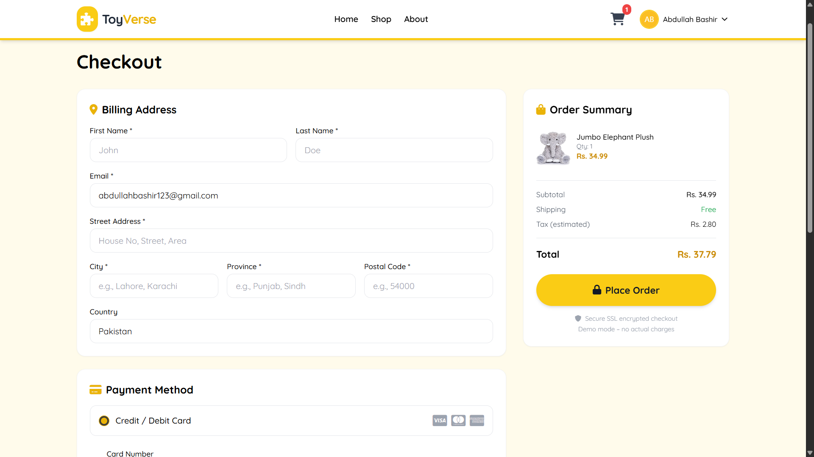
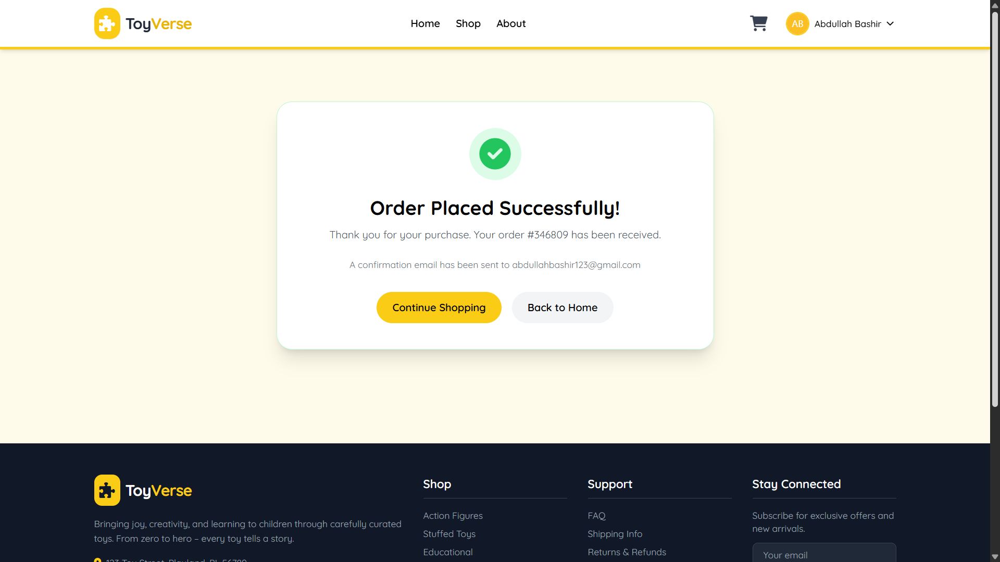

# 🧸 ToyVerse — Full-Stack E-Commerce Toy Store

>## *"From Zero to Hero — where play begins!"*

**ToyVerse** is a fully responsive, full-stack e-commerce platform built with **React** (frontend), **Node.js/Express** (backend), and **SQL Server** (database).
It supports user registration, login, product browsing, cart management, checkout, and order history — all with real database persistence.

---

## 📸 Screenshots

### 🏠 Home

## 🔐 Auth 

## 🛒 Cart


---

### 💳 Checkout 

## ✅ Success



---

## 🚀 Live Demo (Local)

* 🖥️ Frontend: http://localhost:3000
* 🔌 Backend API: http://localhost:5000

---

## ✨ Key Features

* 🔐 Authentication – Signup, login, logout with password hashing (bcrypt)
* 🗄️ SQL Server Integration – Real database tables: Users, LoginLogs, CheckoutOrders
* 🛍️ Product Catalog – Browse toys, view details, filter by category
* 🛒 Cart Management – Add/remove items, update quantities in real-time
* 💳 Checkout Flow – Billing address, payment method (UI), order summary, tax estimation
* 📜 Order History – Every order saved in database
* 📱 Fully Responsive – Tailwind CSS, mobile-first design
* 🎨 Modern UI/UX – Gradient backgrounds, animations, Font Awesome icons
* ⚠️ Robust Error Handling – Frontend alerts for backend issues

---

## 🧰 Tech Stack

| Layer    | Technology                                                      |
| -------- | --------------------------------------------------------------- |
| Frontend | React 19, React Router, Context API, Tailwind CSS, Font Awesome |
| Backend  | Node.js, Express, mssql (tedious), bcrypt, cors                 |
| Database | SQL Server (Express/Developer), T-SQL                           |
| Tools    | SSMS, Git, npm                                                  |

---

## ⚙️ Prerequisites

* Node.js v16+
* SQL Server (Express or Developer) with Mixed Mode authentication
* SQL Server Management Studio (SSMS)

---

## 🛠️ Installation & Setup

> 💡 If you already have the project folder, skip download and start from setup.

---

### 1️⃣ Frontend Setup

```bash
cd toyverse
npm install
npm start
```

App runs at: http://localhost:3000

---

### 2️⃣ Backend Setup

```bash
cd backend
npm install
```

#### 📝 Configure Database Connection

Edit `backend/server.js`:

```javascript
const config = {
  user: 'your_sql_username',
  password: 'your_sql_password',
  server: 'localhost\\SQLEXPRESS',
  database: 'ToyVerseDB',
  port: 1435,
  options: {
    trustServerCertificate: true,
  },
};
```

Start backend:

```bash
npm start
```

Backend runs at: http://localhost:5000

---


---

## 🧪 Running the App

```bash
# Start backend
cd backend
npm start

# Start frontend (new terminal)
cd toyverse
npm start
```

Open: http://localhost:3000

---

## 🗂️ Project Structure

```
toyverse/
│
├── public/
├── src/
│   ├── components/
│   ├── context/
│   ├── data/
│   ├── pages/
│   ├── App.js
│   └── index.js
│
├── backend/
│   ├── server.js
│   └── package.json
│
├── package.json
├── README.md
└── .gitignore
```

---

## 📬 API Endpoints

| Method | Endpoint  | Description   |
| ------ | --------- | ------------- |
| POST   | /signup   | Register user |
| POST   | /login    | Login user    |
| POST   | /checkout | Save order    |

### Example Request Body

```json
{
  "firstName": "John",
  "lastName": "Doe",
  "email": "john@example.com",
  "address": "Street 1",
  "city": "City",
  "state": "State",
  "zipCode": "12345",
  "country": "Country",
  "paymentMethod": "COD",
  "totalAmount": 100,
  "userId": 1
}
```

---

## 🧩 Future Enhancements

* Admin dashboard
* JWT authentication
* Product reviews
* Stripe/PayPal integration
* Email notifications
* Deployment (AWS, Azure, Vercel)

---

## 🤝 Contributing

Pull requests are welcome. Open an issue before major changes.

---

## 📄 License

MIT License — free to use and modify.

---

## 🙏 Acknowledgements

* Tailwind CSS
* Font Awesome
* React Router
* mssql
* bcrypt

---

## 👨‍💻 Author

**Abdullah Bashir**

Made with ❤️
Happy Coding 🚀
